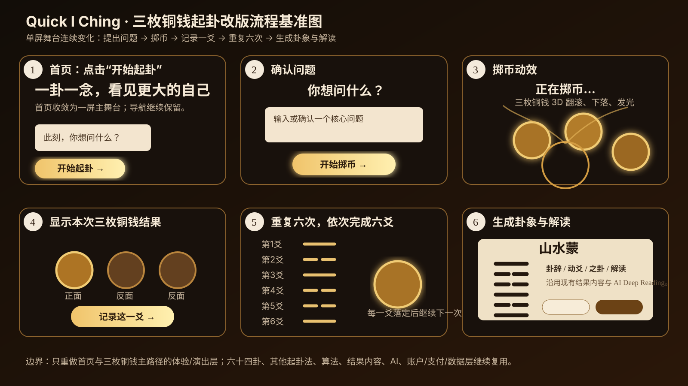

# Quick I Ching 三枚铜钱主流程体验改版需求与技术边界

> 状态：需求已确认，可进入设计资产准备与实现阶段
> 适用仓库：`pyxm1618/quickiching`
> 需求确认基线：`main@b3e0d1bbdeb392d593d9d432f286c2ef0a60979a`
> 本文目的：明确本次改版到底改什么、不改什么，以及三枚铜钱交互如何在现有系统上实现。
> 核心原则：**重做体验层，不重做业务内核；换“演出层”，不推翻现有 Quick I Ching。**
> 视觉最高原则：**本次改版以 100% 像素级还原已确认设计稿，以及 100% 忠实还原已确认动效参考为最高验收标准。不得因为实现方便、性能调优或素材不足，自行改成近似效果、替代效果或“差不多”的方案。缺失任何会影响还原的素材、字体、切图、纹理、遮罩、层级信息、viewport 或动效定义时，必须暂停对应视觉实现并向用户索取 / 确认；未补齐前不得宣称视觉完成。**

---

## 1. 本次改版的目标

本次改版不是重新开发一个 Quick I Ching，也不是重新定义六十四卦内容、起卦算法、结果体系或 AI 解读逻辑。

本次只聚焦两件事：

1. **首页重构为“一屏主舞台”**
   - 首页不再把大量说明性内容从上到下全部铺开；
   - 首屏直接承担“提出问题 + 开始起卦”的核心任务；
   - 三枚铜钱成为视觉与交互主角；
   - 用户点击“开始起卦”后，不通过长页面下拉完成流程，而是在同一视觉舞台中连续发生状态变化。

2. **重做三枚铜钱起卦的表现层与动效**
   - 保留现有问题锁定、随机算法、六次起爻、结果保存、六爻计算、结果页、免费解读、AI Deep Reading 等业务逻辑；
   - 将当前相对简单的 CSS 3D 铜钱与页面布局升级为更具仪式感的 3D 铜钱演出；
   - 用户视觉上应感受到一个连续流程，而不是“跳来跳去的多个表单页面”。

---

## 2. 核心体验参考图

> 上图是对本次已确认六阶段效果图的仓库化流程复刻，用于把流程和关键状态固定在代码库中。
> **最终视觉还原仍以用户已确认的原始效果图为最高视觉基准；本 SVG 不能替代原始效果图成为新的设计稿。**
> 开发过程中不允许自行扩散设计语言。

六个关键状态：

1. 首页：提出问题，点击“开始起卦”
2. 确认问题
3. 三枚铜钱进入掷币动态
4. 显示本次三枚铜钱正反面，并记录一爻
5. 重复六次，依次生成六爻
6. 六爻完成，生成本卦 / 动爻 / 之卦及解读

---

# 3. 最重要的产品边界

## 3.1 这是“改造”，不是“推翻”

本次改版不能被理解成：

- 删除六十四卦；
- 删除原有内容；
- 重做起卦算法；
- 重做结果系统；
- 重做 AI；
- 重做账户、支付或数据库；
- 将其他起卦方式强行改成与三枚铜钱相同的交互；
- 新建一套和现有系统并行的独立业务链路。

正确理解应是：

> **在现有 Quick I Ching 的内容层、领域层和结果层之上，重做首页与三枚铜钱主路径的用户体验和演出方式。**

---

# 4. 哪些必须保留，不允许因为改版而删除

## 4.1 六十四卦内容体系：全部保留

现有六十四卦是项目的重要内容资产，不属于本次改版删除范围。

包括但不限于：

- `/zh/hexagrams`
- `/zh/hexagrams/[slug]`
- 英文对应页面
- 六十四卦内容数据
- 卦象主题、核心意义
- 爻辞 / 爻位解释
- SEO 内容
- 相关指南
- 经典来源与 provenance

现有相关实现包括：

- `src/content/hexagrams/`
- `src/domain/interpretation/v2/catalog/`
- `src/app/(localized)/zh/hexagrams/`
- `src/components/hexagram-detail-page.tsx`

**结论：六十四卦继续作为一级内容资产存在。**

顶部导航中的“六十四卦”入口继续保留。

---

## 4.2 其他起卦方式：全部保留

现有方法包括：

- 三枚铜钱
- 蓍草
- 梅花易数
- 手动起卦

相关页面继续保留，例如：

- `/zh/methods/three-coin`
- `/zh/methods/yarrow-stalks`
- `/zh/methods/mei-hua-yi-shu`
- `/zh/methods/manual-cast`

本次只重点重做“三枚铜钱”主路径的体验。

其他方法当前阶段只需要：

- 保留导航入口；
- 保留原有页面；
- 保留原有算法；
- 保留原有结果体系。

**不允许为了所谓“统一体验”而同时重构梅花易数、蓍草或手动起卦。**

---

## 4.3 三枚铜钱算法：保留

当前三枚铜钱算法已经明确：

- 阳面 = 3
- 阴面 = 2
- 三枚铜钱相加得到 6 / 7 / 8 / 9
- 共六次
- 自下而上形成六爻
- 6 / 9 为动爻

核心实现：

`src/domain/casting/three-coin/algorithm.ts`

本次改版不得改变其含义或概率逻辑。

动画结果必须严格服从已经生成的真实结果。

**禁止：先随机播放动画，再根据动画“猜”结果。**

正确关系必须是：

> 先由现有算法生成权威结果 → 再驱动 3D 动画以对应正反面落定。

---

## 4.4 六爻计算、本卦 / 动爻 / 之卦：保留

现有确定性计算继续复用：

`src/domain/casting/hexagrams/compute.ts`

不允许为了新视觉重新实现另一套卦象计算。

---

## 4.5 免费解读与六十四卦解释：保留

现有解释系统继续复用：

- `src/domain/interpretation/`
- `src/domain/interpretation/v2/`
- `src/components/public-reading/public-reading-result.tsx`
- 三枚铜钱现有结果组件

本次改版可以改变结果如何“进入画面”，但不能随意重写结果内容和逻辑。

---

## 4.6 AI Deep Reading：保留

现有 AI Deep Reading：

- 问题上下文
- 用户现实背景
- 卦象事实
- 动爻
- 之卦
- 内容知识
- 风险控制
- 登录
- credit / entitlement
- 生成服务

均不属于本次改版范围。

只需要保证新流程完成起卦后，仍能无缝进入现有 Deep Reading 能力。

---

## 4.7 历史记录、账户、支付、数据库：保留

以下系统不因本次视觉改版而重做：

- History
- Account
- Auth
- Payment
- Credit / Entitlement
- Database
- Drizzle migrations
- API contract

除非实际集成新 UI 时出现必要的兼容性调整，否则不允许扩散。

---

## 4.8 登录时机：不打断起卦，只在用户主动进入 Deep Reading 时触发

本次新流程必须明确登录时机，不能由实现方自行决定。

固定规则：

1. **首页提问不要求登录。**
2. **六次三枚铜钱起卦不要求登录。**
3. **查看六爻、本卦、动爻、之卦和现有免费解读不要求登录。**
4. 起卦主仪式过程中不得突然弹出登录，也不得为了保存免费起卦强制用户先登录。
5. 只有当用户在结果阶段主动选择 **AI Deep Reading / 个性化深度解读** 时，才进入现有登录与商业流程。
6. 如果用户此时未登录：
   - 点击 Deep Reading CTA 后进入现有 Sign In；
   - 登录完成后必须返回当前这一次已完成的起卦结果；
   - 不得要求用户重新起卦。
7. 如果用户已经登录：
   - 不重复要求登录；
   - 继续使用现有 credit / entitlement 判断。
8. 已登录但没有可用 credit：
   - 继续进入现有 pricing / pack 流程；
   - 不改变当前已完成起卦结果。
9. 有可用 credit：
   - 继续调用现有 Deep Reading 能力。

因此本次登录体验的产品原则固定为：

> **先免费完成一次完整起卦并看到结果；只有用户主动要求个性化 Deep Reading 时，才要求登录 / 购买。登录不能打断“提问 → 六次起爻 → 成卦 → 免费结果”主流程。**

这不是重做 Auth / Payment，而是把现有登录与付费能力正确接到新的结果阶段。

---

# 5. 首页到底怎么改

## 5.1 当前问题

当前首页承载了大量内容模块，包括：

- Hero
- 三枚铜钱工具
- 其他方法
- How it works
- 卦象说明
- FAQ
- 其他 SEO / 内容模块

从产品体验角度，本次改版要把视觉重心重新集中到：

> **提出一个问题 → 开始起卦。**

因此首页不应再以“长内容页”作为主要体验。

---

## 5.2 新首页原则

新首页采用“一屏主舞台”，**首页本身不再向下继续第二屏、第三屏的主要内容流**。

首屏只保留当前已确认的核心内容：

- Quick I Ching 品牌 / 顶部导航；
- 主标题；
- 极少量辅助文案；
- 问题输入框；
- “开始起卦”主按钮；
- 右侧铜钱主视觉。

六十四卦、其他起卦方法、历史记录等现有能力继续通过顶部导航或既有入口访问，不因为首页收敛而删除。

**“每日一卦”等未完成产品定义、未确认设计、未形成现有稳定功能的内容，本次暂缓，不新增占位模块，不借本次改版顺手开发。**

首页首屏不应被额外说明模块或新功能入口抢走注意力。

---

## 5.3 “首页内容减少”不等于“内容资产删除”

这是本次改版最容易被误解的地方。

首页即使不再展示大量旧内容，也不代表：

- 六十四卦被删除；
- 方法说明被删除；
- 指南被删除；
- FAQ 永久消失；
- SEO 内容无条件全部删掉。

需要分别处理：

- **首页视觉层**：大幅收敛；
- **站点内容层**：继续存在；
- **独立内容页 / 方法页 / 卦详情页**：继续保留；
- **SEO 是否需要保留部分首页正文**：实施时必须单独核对现有 SEO gate，不允许为了视觉效果直接破坏已经完成的 SEO 结构。

因此开发时应遵守：

> 先区分“首页不再显眼展示”与“删除内容资产”，禁止直接把两者等同。

---

# 6. 单屏起卦是什么意思

“单屏”不是说整个网站只能有一个 URL。

这里的“单屏”指：

> **用户在起卦主流程中，视觉上始终处于同一个舞台，而不是通过纵向长页面滚动或连续跳到风格完全不同的页面。**

典型表现：

- 首页元素退场；
- 新提示进入；
- 铜钱进入；
- 铜钱开始运动；
- 结果落定；
- 六爻逐步生成；
- 第六爻后卦象进入；
- 结果内容接上。

这属于**连续状态演出**。

---

# 7. 六阶段详细流程

## 阶段 1：首页初始态

初始首页就是已确认设计稿的第一屏。

保持：

- 顶部导航；
- 背景场景；
- 主标题；
- 简短辅助文案；
- 问题输入框；
- “开始起卦”按钮；
- 右侧铜钱主视觉。

此时铜钱主要承担视觉吸引，不是正在起卦的操作区。

用户在输入框中填写本次要问的问题，然后点击“开始起卦”。

---

## 阶段 2：问题确认态

点击“开始起卦”后，**不跳转页面，不向下滚动**。

发生以下确定变化：

- 顶部导航保持不动；
- 背景场景保持连续，不切换成另一套页面；
- 首页主标题、辅助文案等宣传性内容淡出 / 滑出；
- 右侧作为首页主视觉的铜钱从原位置退场或进入下一状态；
- **问题不消失**；
- 问题输入区域从首页原位置平移到页面中央并成为当前焦点；
- 已输入的问题继续完整显示；
- 主操作按钮切换为“开始掷币”。

这一阶段的目的只有一个：让用户确认“这就是本次要问的问题”。

不新增额外表单，不新增第二套问题输入流程。

---

## 阶段 3：进入起卦舞台

点击“开始掷币”后：

- 中央完整输入框退场 / 收起；
- **问题内容本身仍然保留，不消失**；
- 问题缩成一行弱化的上下文提示，例如“你所问：……”；
- 该问题提示放在不抢视觉的位置，只用于提醒用户本次在问什么；
- 三枚铜钱从首页右侧视觉区域自然过渡到**页面中央主舞台**；
- 此后起卦阶段铜钱保持在中央附近，成为绝对视觉主角；
- 六爻进度开始出现，但不得抢过铜钱。

这里不新开页面。

---

## 阶段 4：掷币与本爻落定

用户触发一次掷币后：

- 三枚 3D 铜钱在中央翻滚、旋转、上升 / 下落；
- 已确认设计稿 / 动效参考中出现的金色粒子、光晕、能量 / 气流必须按参考还原；参考中没有的效果不得自行新增；
- 背景继续保持稳定；
- 动画最终姿态必须严格对应现有算法已经生成的三枚正反面。

动画结束后：

- 三枚铜钱仍在中央清楚落定；
- 显示本次三枚铜钱的正 / 反；
- 显示对应的 6 / 7 / 8 / 9；
- 显示阴 / 阳；
- 若为 6 / 9，清楚体现动爻；
- 出现“记录这一爻”操作。

问题弱提示继续保留，不消失。

---

## 阶段 5：记录并重复六次

点击“记录这一爻”后：

- 当前爻进入六爻进度；
- 六爻必须从下往上逐步形成；
- 中央铜钱恢复到下一次可掷状态；
- 用户继续进行下一次掷币。

循环：

> 掷币 → 落定 → 显示正反面与本爻 → 记录 → 下一次

共六次。

过程中：

- 页面不跳转；
- 不依赖纵向滚动；
- 问题弱提示持续存在；
- 用户始终知道当前是第几爻 / 共六爻；
- 已记录的爻不重新随机；
- 现有浏览器会话保存、恢复、问题锁定与完成判定逻辑继续复用。

---

## 阶段 6：六爻完成，进入卦象与解读

第六爻记录完成后：

- 三枚铜钱作为主角逐渐退场；
- 粒子 / 光效同步收束；
- 已形成的完整六爻成为新的视觉中心；
- 六爻进入完整卦象时的位置、比例、层级和转化方式必须严格按已确认关键帧 / 动效参考执行；若现有参考无法唯一确定，则暂停该转场并向用户确认，不得自行选择表现方式；
- 生成本卦；
- 如有动爻，显示动爻；
- 如有动爻，生成之卦；
- 随后直接接入现有免费解读，**不要求登录**；
- 免费结果完整可见后，再提供 AI Deep Reading CTA；
- 只有用户主动选择 Deep Reading 时才触发现有登录 / credit / pricing 流程；
- 已登录用户不得被重复打断；未登录用户登录后必须返回同一份已完成结果，不重新起卦。

工程上可以继续使用现有 result route，但视觉上必须保持同一场景和同一节奏的连续性，避免用户感到突然跳到了另一个无关页面。

---

# 8. 结果页是否必须强行做成同一个 React 页面

不要求。

当前代码在六爻完成后会进入：

- `/readings/three-coin/result`
- `/zh/readings/three-coin/result`

本次不应为了追求“单屏”而强行废掉现有 result route。

工程实现要求：

- 工程上继续保留现有 Result Route；
- 视觉上让起卦舞台和结果页拥有一致的背景、色彩、过渡和节奏；
- 第六爻完成后使用短过渡进入结果；
- 用户主观感受仍是“一次连续仪式”。

换言之：

> **视觉连续 ≠ 必须技术上只有一个 URL。**

---

# 9. 当前代码中可直接复用的部分

## 9.1 现有 ThreeCoinTool 状态

当前：

`src/components/public-reading/three-coin-tool.tsx`

已经包含：

- `idle`
- `holding`
- `casting`
- `settled`
- 六次起爻
- 当前爻结果
- 正反面
- 浏览器会话
- 音效
- 完成后导航

这些逻辑应该优先保留。

---

## 9.2 当前已有 CSS 动效

`src/app/globals.css`

当前已经存在：

- `coin-held-shake`
- `coin-scatter-fall`
- `coin-scatter-spin`
- `coin-energy`
- CSS `preserve-3d`

因此本项目不是从 0 开始做动效。

本次升级的重点是：

> 从“CSS 模拟 3D”升级到效果图所要求的更真实 3D 铜钱与粒子演出。

---

# 10. 技术方案

## 10.1 页面分层

实现固定分为三层：

### Layer 1：背景层

- 高清静态背景图；
- 只有设计稿 / 动效参考明确存在呼吸、光影或景深变化时才实现，并严格按参考执行；未定义时背景保持静态，不得自行添加；
- 但背景不能成为主要动画对象；
- 背景应服务于铜钱，而不是抢走铜钱注意力。

---

### Layer 2：Three.js / WebGL 演出层

负责：

- 三枚 3D 铜钱；
- 翻滚；
- 空间旋转；
- 下落；
- 铜钱厚度；
- 金属材质；
- 高光；
- 阴影；
- 金色粒子；
- 光轨；
- 气流感；
- 落地能量；
- 必要的 Bloom / emissive 视觉。

---

### Layer 3：HTML / React UI 层

负责：

- 标题；
- 输入框；
- 按钮；
- 进度；
- 第几爻；
- 六爻；
- 本卦；
- 动爻；
- 结果文字；
- 导航；
- 可访问性。

---

# 11. CSS 与 Three.js 的职责边界

## 11.1 CSS 负责

适合用 CSS 的：

- 淡入淡出；
- 左右滑入滑出；
- 上下位移；
- scale；
- blur；
- opacity；
- 文案退场；
- 按钮出现；
- 卡片展开；
- 页面状态切换；
- 轻量 UI 动效。

也就是类似 PPT / Keynote 的“元素进场退场”。

---

## 11.2 Three.js 负责

以下效果不建议继续仅用 CSS：

- 真正 3D 铜钱；
- 铜钱厚度；
- 透视；
- 不同角度下的金属反射；
- 空间翻滚；
- 三枚铜钱独立轨迹；
- 动态光照；
- 粒子；
- 能量；
- 气流；
- 光晕；
- 落地瞬间效果。

---

# 12. 铜钱如何实现

## 12.1 不要求一开始就提供完整 3D 模型

铜钱形态较规则，可以程序化创建：

- 外圆；
- 一定厚度；
- 中央方孔；
- 正面材质；
- 反面材质；
- 侧面金属材质。

因此第一阶段无需强制提供 Blender / GLB 模型。

---

## 12.2 推荐素材

至少需要：

### 铜钱正面

- PNG
- 透明背景
- 完全正视
- 无透视
- 建议 2048 × 2048
- 最低不建议低于 1024 × 1024

### 铜钱反面

同上。

这两张图作为 3D 铜钱正反面的 texture。

---

## 12.3 如果未来要求超高精度近景

若要求：

- 文字真实凹凸；
- 铜钱表面坑洼；
- 旧化；
- 边缘雕刻；
- 光照下凹凸真实变化；

则可补：

- Normal Map
- Roughness Map
- Height Map

或者直接提供：

- `.glb` / `.gltf` 3D 模型

当前阶段不作为必需项。

---

# 13. 粒子、“气”和金色能量如何实现

不要求用户提供 GIF 或视频素材。

可程序化实现：

- Three.js Points
- Sprite particles
- additive blending
- noise texture
- shader
- emissive material
- bloom

典型效果：

- 金色火星；
- 尘埃；
- 上升粒子；
- 铜钱轨迹光线；
- 落地光爆；
- 半透明能量流；
- 轻烟 / 气。

---

# 14. 像素级还原是硬性验收门槛

## 14.1 静态 UI：100% 像素级对齐

Desktop 主验收必须先锁定唯一基准环境：

- 原始设计稿画布 / viewport；
- 浏览器与缩放比例；
- 字体及字重；
- 背景与所有视觉素材；
- 关键状态对应的原始设计稿。

在该基准环境下，Landing、Question Confirm、Casting、Settled、Six-line progress、Result transition 等关键状态必须执行截图 overlay / difference 对比。

验收对象包括：

- 构图；
- x / y 位置；
- 宽高；
- 间距；
- 字体；
- 字号；
- 字重；
- 行高；
- 颜色；
- 透明度；
- blur；
- 阴影；
- 铜钱大小、角度、厚度、材质和高光；
- 粒子密度、粒径、范围和亮度；
- 光效位置、范围和强度；
- 前后景层级；
- 六爻与卦象位置。

**目标是 100% 像素级还原，不以“非常接近”“肉眼差不多”作为通过标准。**

任何无法对齐的项都必须继续修正；如果原因是缺字体、缺源素材、缺设计尺寸或缺分层信息，则标记 # 15. 视觉素材与参考输入

当前六阶段效果图负责定义已确认关键状态，但像素级实现还必须逐项核对实际所需素材。

## 已知必需输入

1. **最终确认的干净背景图**
   - 不含 UI；
   - 不含动态铜钱；
   - 分辨率足以覆盖主验收 viewport；
   - 构图与确认稿一致。

2. **铜钱正面高清透明图**
   - PNG；
   - 透明背景；
   - 完全正视；
   - 无透视；
   - 分辨率必须足以支持设计稿中的最大显示尺寸与近景。

3. **铜钱反面高清透明图**
   - 要求同正面。

4. **原始设计稿的准确 Desktop viewport / 画布尺寸**。

5. **设计稿实际使用的字体 / 字重信息**。
   - 如果项目中不存在对应字体或合法可用的 Web Font，必须向用户索取 / 确认替代方案；
   - 未确认前不得自行换字体后宣称像素级完成。

6. **所有需要独立运动或独立景深的额外图层**
   - 前景遮罩；
   - 雾层；
   - 光层；
   - 特殊纹理；
   - 其他无法从干净背景中正确分离的设计元素。

缺少任何会影响最终还原的必需项时：

> **ASSET BLOCKED：停止对应视觉实现并向用户索取。**

禁止使用：

- 占位图；
- 临时 AI 图；
- 其他项目素材；
- 互联网近似素材；
- 从压缩效果图粗暴裁切出的低质量最终素材；
- CSS 临时伪造后直接作为最终版本。

## 条件必需的动效参考

如果静态关键帧不能唯一确定最终运动方式，则 Motion Reference 不再是“可选优化项”，而是**完成该段动效的必需输入**。

可以接受：

- 视频；
- GIF；
- 连续关键帧；
- 用户明确确认的轨迹 / duration / easing / 时序说明。

在这些信息补齐前，该段动效不得以开发者自主设计的版本收口。

## 高精度铜钱补充素材

如果正反面贴图 + 程序化几何无法达到设计稿中的近景材质要求，则继续向用户索取：

- normal map；
- roughness map；
- height map；
- displacement / mask；
- 或 GLB / GLTF 模型。

不能因为这些素材暂时缺失，就降低设计稿中的铜钱质感要求。

---

# 16. Header / 导航

本次改版不应顺手重新设计全站信息架构。

应保留现有核心入口：

- 起卦 / 方法
- 六十四卦
- 指南
- 历史记录
- 账户相关

本次可以根据新首页视觉适配 Header 样式，但不应借机重构所有导航逻辑。

梅花易数、蓍草等其他方法继续在“方法”入口中存在即可。

---

# 17. 桌面与移动端

## Desktop

Desktop 是本次效果图的主验收目标。

需要优先保证：

- 一屏构图；
- 三枚铜钱视觉；
- 3D 动效；
- 粒子；
- 六爻生成；
- 结果转场。

## Mobile

Desktop 是本次 100% 像素级主验收环境。

如果另有已确认 Mobile 设计稿，则 Mobile 同样按对应设计稿还原。

如果当前没有 Mobile 设计稿，移动端只允许做**功能性兼容版本**，不得由开发者自行设计并宣称视觉完成。此兼容版本可以为性能与可用性降低粒子、Bloom 或 3D 复杂度，但必须明确标记为非像素级主验收版本。

无论 Desktop 或 Mobile，都不能：

- 改变起卦规则；
- 隐藏结果事实；
- 改成完全不同的业务流程。

---

# 18. 性能与降级

Three.js 引入后必须考虑：

- dynamic import；
- Canvas 生命周期；
- GPU 资源释放；
- texture 压缩；
- DPR 限制；
- mobile particle count；
- `prefers-reduced-motion`；
- WebGL 不可用时的 fallback。

Fallback 仅用于 WebGL 不可用、reduced motion 或设备能力不足的兼容场景，可以降低视觉复杂度，但不得影响起卦业务，也不得替代 Desktop 标准环境的 100% 像素级主版本。

也就是说：

> 即使 3D 失败，用户仍应能完成真实三枚铜钱起卦。

---

# 19. 真实性约束

本次改版最重要的工程约束之一：

### 动画不能决定结果

结果来源必须继续是现有真实算法。

例如：

1. 用户触发起爻；
2. `generateThreeCoinLine(...)` 生成：
   - 三枚 coinFaces
   - lineValue
3. 结果先成为权威状态；
4. 动画根据 coinFaces 设计最终姿态；
5. 动画结束；
6. 展示完全一致的三枚正反面；
7. 保存并记录本爻。

不能因为 3D 物理模拟“碰巧落成另一面”而改变业务结果。

如果使用物理效果，物理动画也必须是**受控演出**，而不是业务随机源。

---

# 20. 不允许的扩散

本 PRD 明确禁止以下行为：

- 不重写六十四卦；
- 不重写三枚铜钱算法；
- 不重写卦象映射；
- 不重写 AI；
- 不改数据库模型；
- 不新增 migration；
- 不重做付费；
- 不重做账号；
- 不重做 History；
- 不重构梅花易数；
- 不重构蓍草；
- 不重构手动起卦；
- 不为了动效引入完整游戏引擎；
- 不擅自改站点品牌定位；
- 不擅自增加新的占卜玩法；
- 不擅自增加用户未确认的游戏化机制；
- 不新增“每日一卦”等本次未定义、未设计、未确认的功能；
- 不因为首页变短就直接删除现有 SEO / 内容资产；
- 不为了制造 diff 改无关文件。

---

# 21. 推荐实施范围

本次真正允许重点修改的范围应集中在：

- `src/app/(default)/page.tsx`
- `src/app/(localized)/zh/page.tsx`
- `src/components/public-reading/question-first.tsx`（仅必要交互适配）
- `src/components/public-reading/three-coin-tool.tsx`
- 新增专用 Three.js scene / coin components
- 与该 scene 对应的样式
- 必要的静态视觉资产
- 三枚铜钱相关测试
- 必要的 E2E / browser gate 更新

结果页只做必要的视觉衔接，不应借此重构其业务逻辑。

---

# 22. 验收标准

## 产品

- 首页视觉重心明确落在“提出问题 + 起卦”；
- 用户不依赖页面下拉完成三枚铜钱主流程；
- 三枚铜钱是整个起卦过程中的视觉主角；
- 六次起爻流程清楚；
- 六爻逐步生成；
- 第六爻完成后自然进入卦象结果；
- 六十四卦、其他方法、结果内容和 AI 都继续存在。

## 视觉

- Desktop 指定 viewport 与原始设计关键帧执行截图 overlay / difference 对比；
- 页面构图、位置、尺寸、字体、间距、颜色、透明度、阴影、blur、层级必须按稿；
- 铜钱大小、厚度、透视、材质、高光和最终姿态必须按稿；
- 粒子、光、气的形态、密度、范围、亮度必须按稿；
- 页面元素退场 / 进场时序必须按已确认动效参考；
- 最终结果页与起卦场景的视觉连续性必须按已确认参考；
- 不接受“接近”“类似”“差不多”作为视觉 PASS；
- 缺素材或缺动效定义时只能标记 BLOCKED，不能自行补齐。

## 业务真实性

- 每次三枚铜钱与算法结果严格一致；
- 6 / 7 / 8 / 9 正确；
- 动爻正确；
- 本卦正确；
- 之卦正确；
- 问题锁定逻辑不回退；
- 存储恢复不回退；
- 已落定结果不会因动画重播而变化。

## 工程

- 不改无关业务；
- 不产生第二套算法；
- 不产生第二套 result domain；
- WebGL 失败不阻断起卦；
- reduced motion 有合理降级；
- 现有测试 / gate 不因无关重构被破坏。

---

# 23. 最终定义

本次需求可以用一句话定义：

> **在保留 Quick I Ching 现有六十四卦、起卦算法、结果体系、AI 解读、其他起卦方式和业务基础设施的前提下，将首页与三枚铜钱主路径改造成一个以三枚 3D 铜钱为视觉核心、在同一舞台连续完成“提问 → 六次起爻 → 成卦 → 解读”的高品质仪式化体验。**

这句话是本次开发的最高边界。

任何修改如果不能直接服务于上述目标，都应默认视为超出本次范围。
